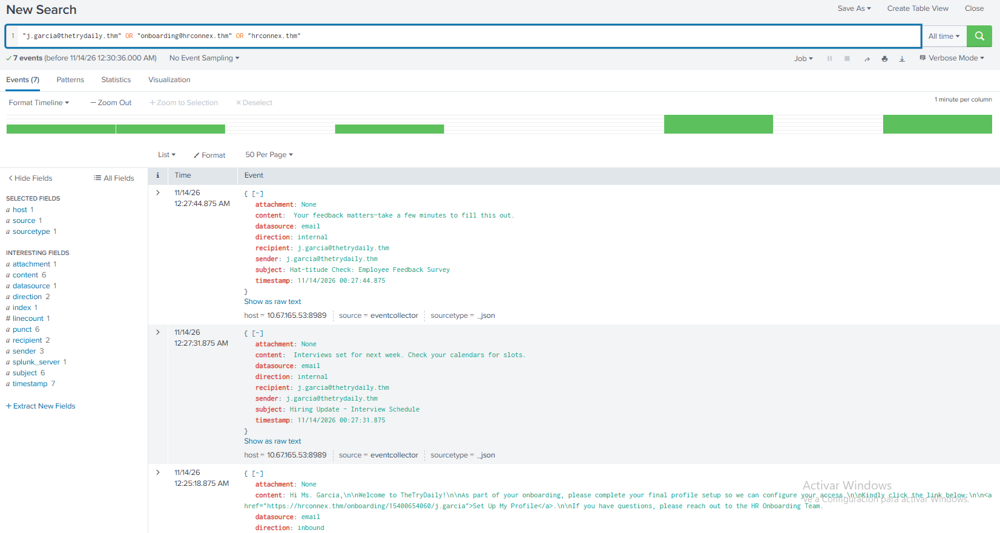
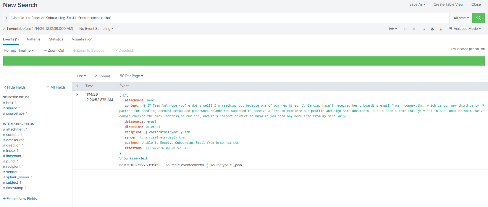
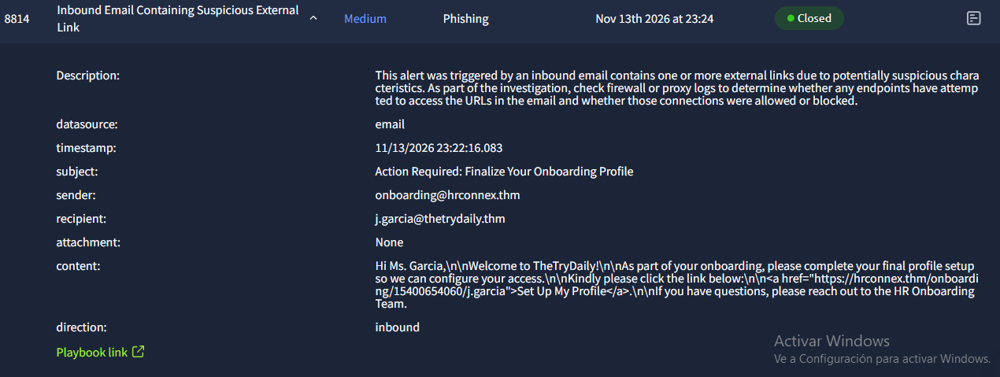
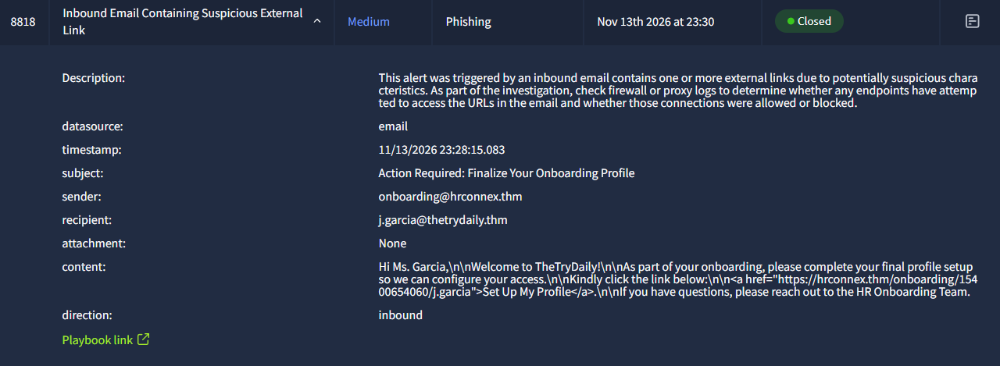

# Escenario 1: correo legítimo de onboarding

> [Leer el Incident Report completo](INCIDENT-REPORT.md)

## Resumen

Las alertas 8814 y 8818 se activaron por correos entrantes que contenían un enlace externo. El análisis determinó que se trataba de comunicaciones legítimas del proceso de incorporación y que ambos eventos compartían los mismos indicadores.

## Alertas relacionadas

- 8814 — Inbound Email Containing Suspicious External Link
- 8818 — Inbound Email Containing Suspicious External Link

## Clasificación

**Falso positivo.** El dominio del remitente coincidía con el dominio del enlace, no había archivos adjuntos y no se identificaron redirecciones, suplantación ni contenido malicioso.

## Entidades

- Remitente: `onboarding@hrconnex.thm`
- Destinataria: `j.garcia@thetrydaily.thm`
- URL: `https://hrconnex.thm/onboarding/15400654060/j.garcia`
- Asunto: `Action Required: Finalize Your Onboarding Profile`

## Evidencias

### Búsqueda de eventos relacionados

La búsqueda por destinataria, remitente y dominio devolvió siete eventos. Entre ellos aparecen el correo de onboarding y actividad interna de la destinataria.

### Confirmación del proveedor de Recursos Humanos

Un correo interno enviado por `h.harris@thetrydaily.thm` a `j.carter@thetrydaily.thm` identifica expresamente a `hrconnex.thm` como el nuevo proveedor externo de Recursos Humanos encargado de la configuración de cuentas y documentación. El mensaje también confirma que J. Garcia esperaba recibir el enlace de incorporación.

Esta evidencia proporciona contexto empresarial independiente y respalda la clasificación como falso positivo.

### Alertas correlacionadas

Las alertas 8814 y 8818 contienen el mismo remitente, destinataria, asunto y URL, por lo que se trataron como eventos relacionados del mismo escenario.

