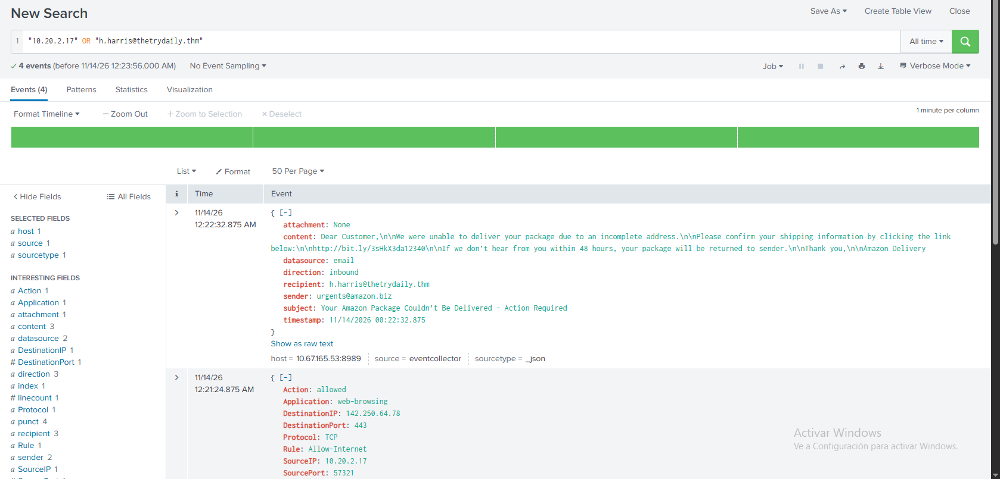
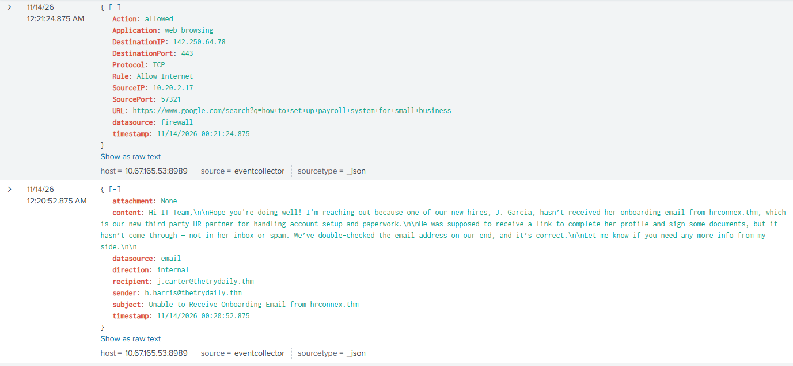
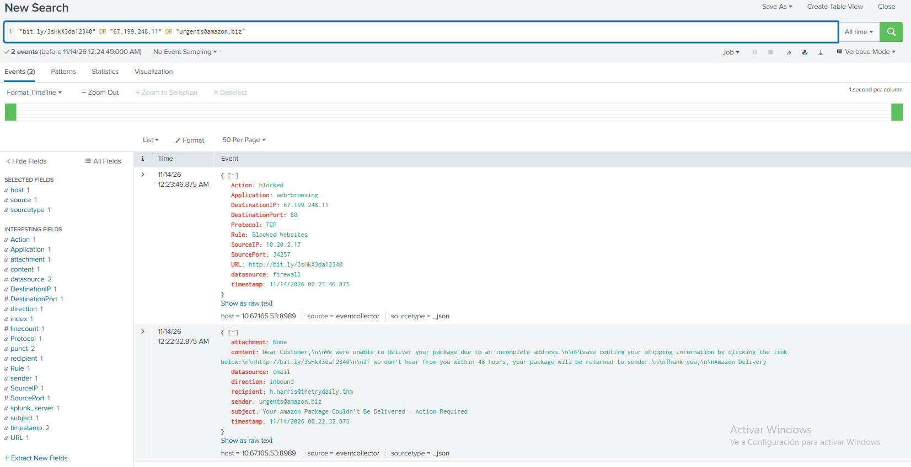
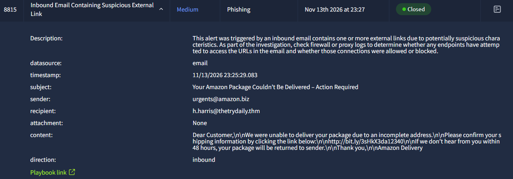
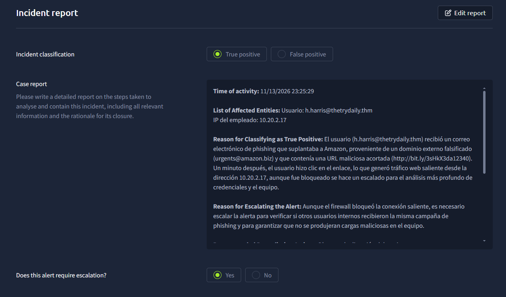
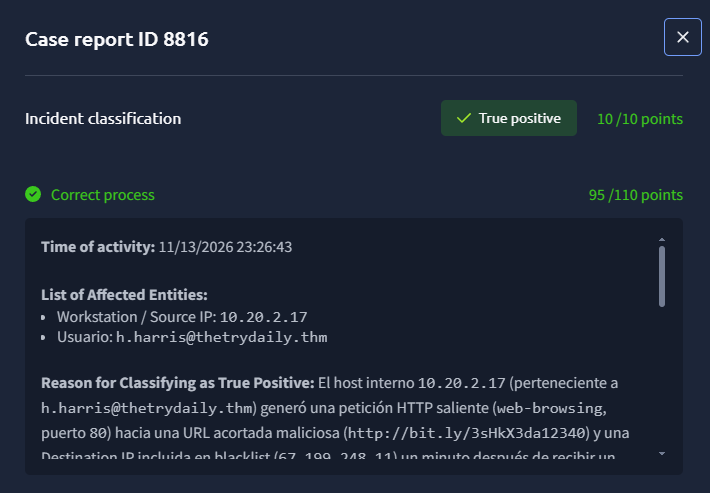

# Escenario 2: phishing de Amazon y bloqueo de firewall

> [Leer el Incident Report completo](INCIDENT-REPORT.md)

## Resumen

El usuario recibió un correo que suplantaba a Amazon y accedió a una URL acortada. La alerta de correo 8815 se correlacionó con la alerta de firewall 8816. El intento de conexión fue bloqueado antes de establecerse y no se observó actividad maliciosa posterior.

## Línea temporal

| Fuente | Hora mostrada | Evento |
|---|---|---|
| Splunk | 14/11/2026 00:22:32.875 | Recepción del correo de phishing |
| Splunk | 14/11/2026 00:23:46.875 | Intento de conexión HTTP bloqueado por el firewall |

La diferencia entre ambos eventos es de **1 minuto y 14 segundos**. Las pantallas de gestión de casos muestran otras horas debido al contexto horario o normalización de timestamps del laboratorio; por eso, para esta correlación se utilizaron las marcas temporales de una misma fuente: Splunk.

## Clasificación

**Verdadero positivo.** Se confirmó la interacción del usuario con el enlace malicioso. La diferencia entre ambos eventos fue de aproximadamente 1 minuto y 14 segundos.

## Entidades e indicadores

- Usuario: `h.harris@thetrydaily.thm`
- Equipo: `10.20.2.17`
- Remitente: `urgents@amazon.biz`
- URL: `http://bit.ly/3sHkX3da12340`
- IP de destino: `67.199.248.11`
- Acción del firewall: `blocked`
- Regla: `Blocked Websites`

## Respuesta

La conexión quedó contenida por el firewall. Se recomendó bloquear los indicadores, retirar el correo de otras bandejas, monitorear el equipo y realizar concientización con el usuario.

## Evidencias

### Actividad del usuario y del equipo

La búsqueda por `10.20.2.17` y `h.harris@thetrydaily.thm` devolvió cuatro eventos, incluyendo el correo de phishing, actividad web legítima y otros mensajes relacionados con el usuario.

### Actividad legítima anterior

Antes del intento malicioso se observó una conexión HTTPS permitida hacia Google mediante la regla `Allow-Internet`. Esto ayuda a establecer el contexto normal previo del equipo.

### Correlación entre el correo y el firewall

La búsqueda conjunta de la URL, la IP de destino y el remitente muestra el correo a las `00:22:32.875` y el intento bloqueado a las `00:23:46.875`. El evento de firewall confirma:

- `Action: blocked`
- `Application: web-browsing`
- `DestinationIP: 67.199.248.11`
- `DestinationPort: 80`
- `Protocol: TCP`
- `Rule: Blocked Websites`
- `SourceIP: 10.20.2.17`
- `URL: http://bit.ly/3sHkX3da12340`

### Alertas y resolución en la plataforma SOC

La alerta 8815 muestra el correo de suplantación de Amazon y la URL acortada. El caso fue clasificado como verdadero positivo y escalado debido a la interacción del usuario.

La alerta correlacionada de firewall 8816 fue resuelta como verdadero positivo. La conexión estaba contenida porque el firewall la bloqueó y no se identificó actividad maliciosa posterior.

