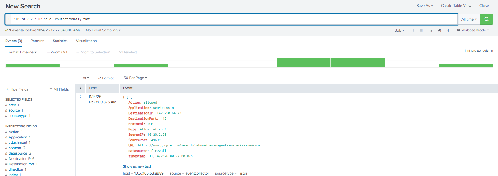
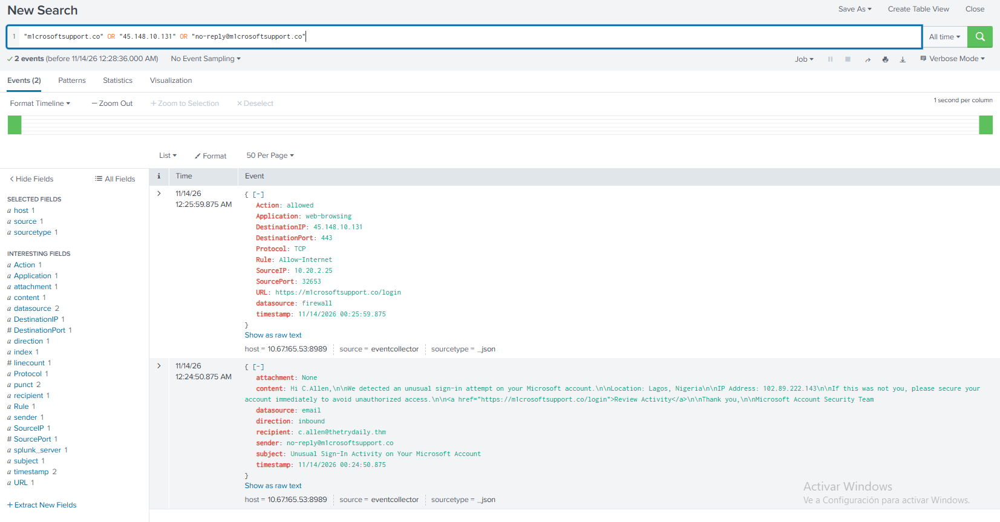
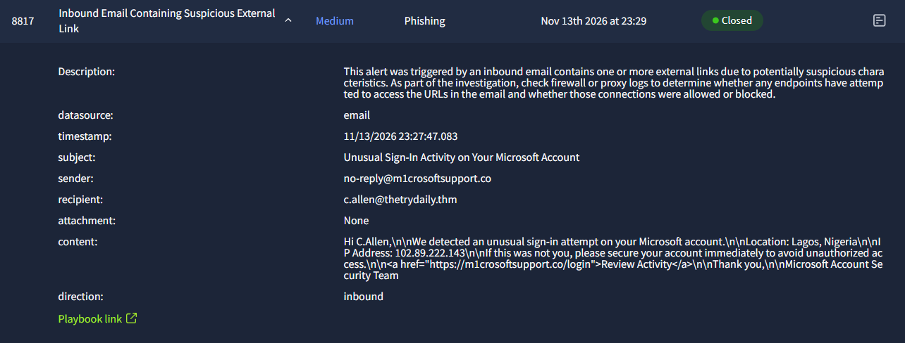
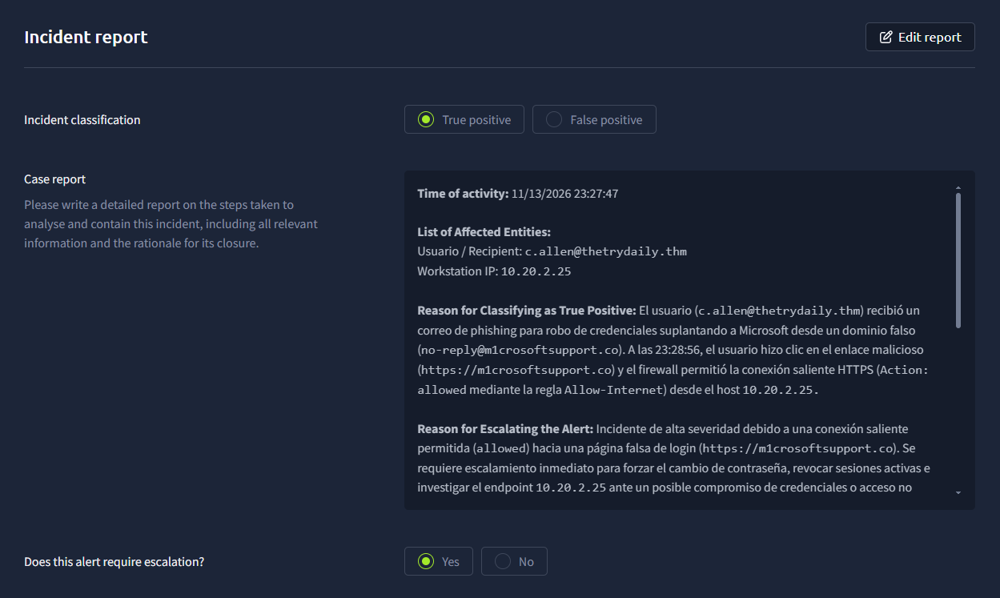

# Escenario 3: suplantación de Microsoft para robo de credenciales

> [Leer el Incident Report completo](INCIDENT-REPORT.md)

## Resumen

El usuario recibió un correo que simulaba una alerta de inicio de sesión de Microsoft. El dominio empleaba el número `1` en `m1crosoft` para engañar al destinatario. El usuario accedió al enlace y el firewall permitió la conexión, por lo que el caso requirió escalamiento.

## Clasificación

**Verdadero positivo con escalamiento.** El acceso al sitio no demuestra por sí solo que se hayan ingresado credenciales, pero crea un riesgo suficiente para investigar la cuenta y el endpoint.

## Entidades e indicadores

- Usuario: `c.allen@thetrydaily.thm`
- Equipo: `10.20.2.25`
- Remitente: `no-reply@m1crosoftsupport.co`
- URL: `https://m1crosoftsupport.co/login`
- IP de destino: `45.148.10.131`
- IP utilizada como señuelo en el correo: `102.89.222.143`
- Acción del firewall: `allowed`
- Regla: `Allow-Internet`

## Línea temporal

| Fuente | Hora mostrada | Evento |
|---|---|---|
| Splunk | 14/11/2026 00:24:50.875 | Recepción del correo de phishing |
| Splunk | 14/11/2026 00:25:59.875 | Conexión HTTPS permitida hacia el sitio falso |

El acceso ocurrió **1 minuto y 9 segundos** después de la recepción del correo. Para la correlación se utilizaron las marcas temporales de Splunk, evitando mezclar horarios normalizados por otras pantallas del laboratorio.

## Respuesta recomendada

- Restablecer la contraseña y revocar sesiones activas.
- Comprobar y aplicar MFA.
- Revisar los registros de autenticación.
- Bloquear el dominio, la URL y la IP de destino.
- Aislar y analizar el equipo afectado.
- Buscar otros destinatarios de la campaña.

## Evidencias

### Actividad general del endpoint

La búsqueda por el equipo `10.20.2.25` y el usuario `c.allen@thetrydaily.thm` devolvió nueve eventos. La línea temporal permite revisar la actividad anterior y posterior al acceso al sitio falso.

### Correlación del correo con la conexión permitida

La búsqueda conjunta del dominio, la IP de destino y el remitente muestra los dos eventos determinantes en una sola vista:

1. El correo de phishing recibido a las `00:24:50.875`.
2. La conexión permitida a `https://m1crosoftsupport.co/login` a las `00:25:59.875`.

El registro de firewall confirma:

- `Action: allowed`
- `Application: web-browsing`
- `DestinationIP: 45.148.10.131`
- `DestinationPort: 443`
- `Protocol: TCP`
- `Rule: Allow-Internet`
- `SourceIP: 10.20.2.25`
- `URL: https://m1crosoftsupport.co/login`

### Alerta y escalamiento en la plataforma SOC

La alerta 8817 contiene el dominio visualmente engañoso y la URL falsa de inicio de sesión. El informe fue clasificado como verdadero positivo y marcado para escalamiento debido a que la conexión fue permitida.

